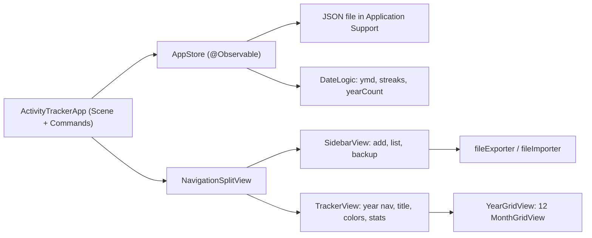

# Native macOS rewrite (SwiftUI)

Rewrite the vanilla HTML/CSS/JS activity tracker as a native macOS SwiftUI app with no web view. Keep the same data model and JSON backup format so existing web backups can be imported.

## Current state
- [app.js](app.js) holds everything: state `{ activities, marks, selectedId }`, `localStorage` persistence, `sanitize`, `streaks`, `yearCount`, rendering, and events.
- [index.html](index.html) has a sidebar (add form, list, backup) and a detail pane (year nav, mark today, title, colors, stats, remove, 12-month grid).
- No build step and no backend, so there is no server to port.

## Target architecture

New folder `ActivityTracker/`, an Xcode project targeting macOS 14+ (needed for `@Observable`). The web app stays as it is.

## Steps

1. **Create the project.** Make a SwiftUI macOS app with App Sandbox on and the "User Selected File: Read/Write" entitlement for backups.
2. **Port the model.** `Activity: Codable, Identifiable { id: String, name: String, color: String }` and `AppState: Codable { activities, marks: [String: [String]], selectedId }`. Keep the JSON keys identical to the web state so backups work in both apps.
3. **Port the logic as pure Swift.** Port `cleanName`, `isYmd`, `ymd`/`parseYmd`/`addDays` (use the local `Calendar`), `sanitize`, `nextColor`, `yearCount`, and `streaks`. Write XCTest unit tests for streaks across month and year boundaries, gaps, and empty input.
4. **Add the store.** `AppStore` is `@Observable` and owns `state` and `year`. It handles add, select, rename, color, toggleDate, remove, and import. It saves to `~/Library/Application Support/ActivityTracker/state.json` with atomic writes after each change.
5. **Build the sidebar.** A `List(selection:)` of activities with a color swatch, name, and year count. An add `TextField` at the top. "Download backup" and "Restore backup" buttons at the bottom.
6. **Build the detail view.** It has:
   - Previous / Next year buttons and a "Mark today" toggle.
   - An editable title `TextField` that trims on submit and falls back to "Untitled".
   - The 8-color picker.
   - Three stat lines.
   - Remove via `.confirmationDialog`.
7. **Build the year grid.** Use `LazyVGrid` with 12 months. Each month has Mo-Su headers, Monday-first padding, and day cells. Marked days fill with the activity color. Today gets an outline. Future days are dimmed. Clicking a day toggles it.
8. **Add backups.** Use `.fileExporter` to write `activity-tracker-YYYY-MM-DD.json`. Use `.fileImporter` to read a backup, run it through `sanitize`, and ask before replacing existing data (as `window.confirm` does now).
9. **Add native polish.** These replace the web-specific bits:
   - Menu commands: Cmd+N new activity, Cmd+T mark today, Cmd+Left/Right change year.
   - Arrow-key focus in the grid via `@FocusState` (replaces the `keydown` handler).
   - VoiceOver labels matching the current `aria-label` text.
   - Dark mode colors.
   - Fonts: bundle Newsreader and Public Sans, or switch to system fonts.
   - Window title: "Name · Activity tracker".
10. **Migrate data.** In the web app, click "Download backup". Then use "Restore backup" in the native app. No automatic `localStorage` migration is possible.
11. **Distribute.** Set signing, Hardened Runtime, and an app icon. Then either notarize for direct download (DMG) or submit to the Mac App Store.
12. **Docs.** Update [README.md](README.md) with build steps for the native app.

## Web-to-native mapping
- `localStorage` becomes a JSON file plus `Codable`.
- DOM render functions become SwiftUI views driven by `AppStore`.
- `aria-*` attributes become `.accessibilityLabel` and `.accessibilityValue`.
- Blob download and file input become `fileExporter` and `fileImporter`.
- CSS variables (`--stamp`) become `Color(hex:)` passed down through the environment.

## Todos
- [ ] Create Xcode SwiftUI macOS 14+ project in `ActivityTracker/` with sandbox + user-selected file entitlement
- [ ] Port model (Codable, same JSON keys) and pure logic (sanitize, ymd, streaks, yearCount) with XCTest
- [ ] Implement `@Observable` `AppStore` with atomic JSON persistence in Application Support
- [ ] Build `SidebarView`: add field, activity list with counts, backup buttons
- [ ] Build `TrackerView`: year nav, mark today, title, color picker, stats, remove confirmation
- [ ] Build `YearGridView`/`MonthGridView` with Monday-first layout, today/future/marked styling
- [ ] Wire `fileExporter`/`fileImporter` with sanitize + replace confirmation
- [ ] Menu shortcuts, arrow-key grid focus, VoiceOver labels, dark mode, fonts
- [ ] Signing, icon, notarization or App Store; update README
